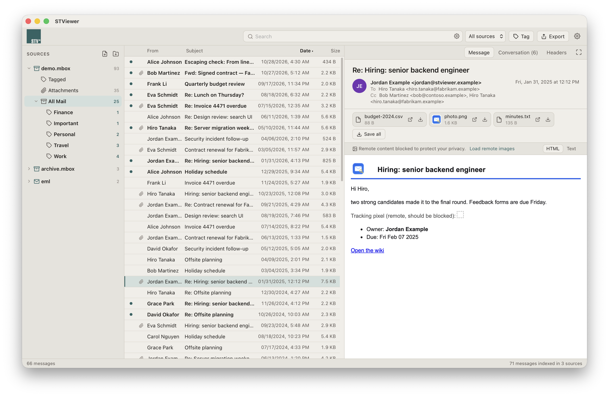
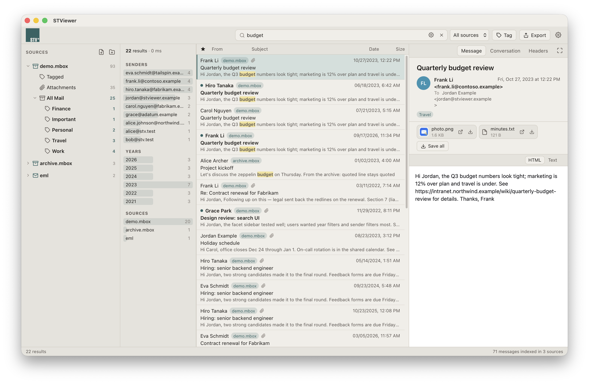
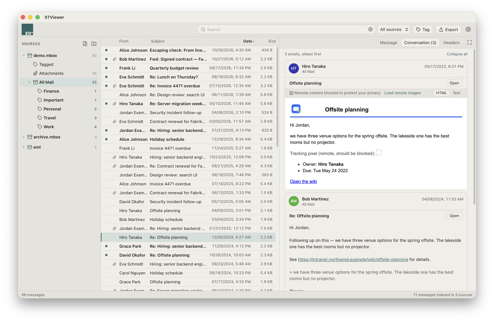
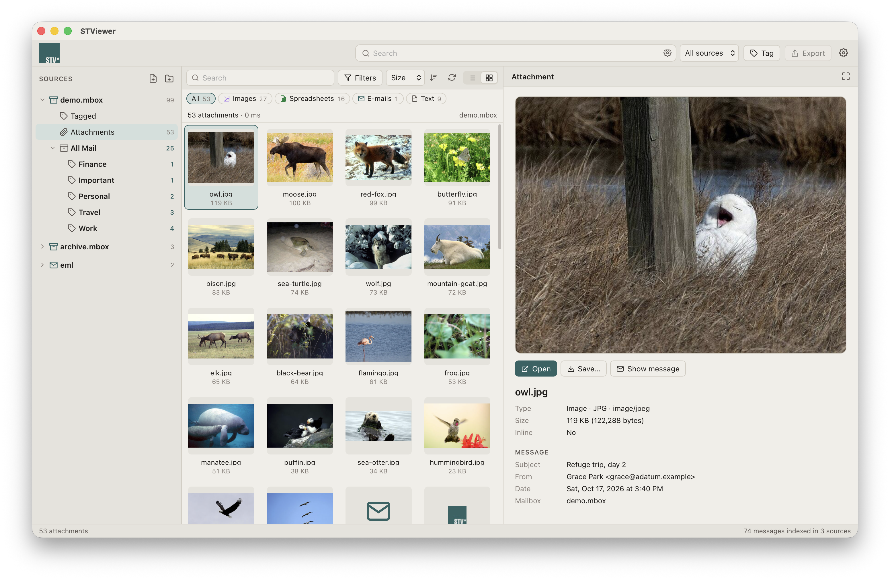
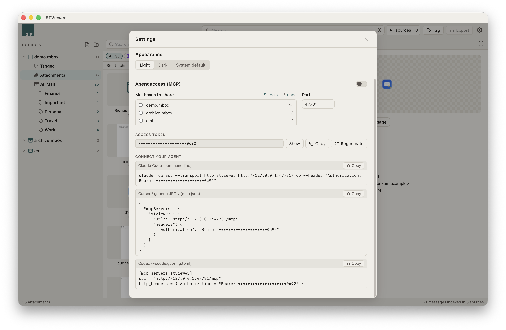
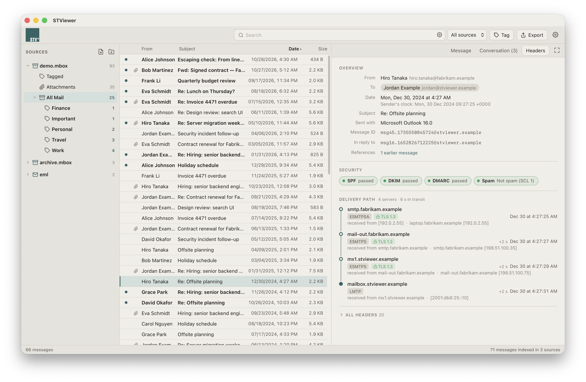
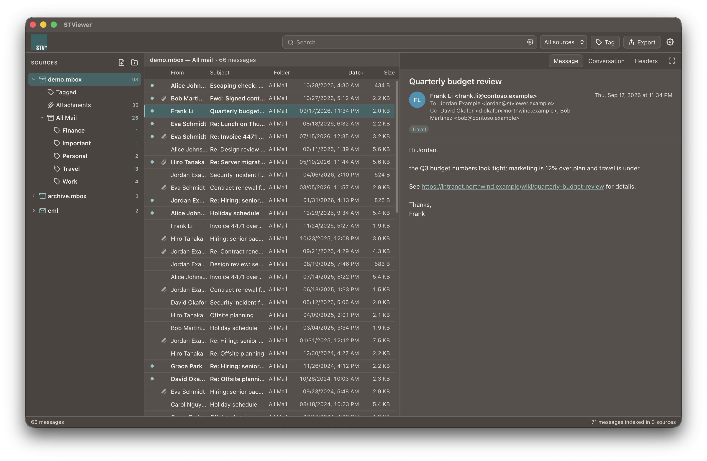

<p align="center">
  
</p>

<h1 align="center">STViewer</h1>

STViewer is a fast, local viewer and search tool for email archives, written in Rust. It
has a desktop app (Tauri) for Windows, macOS and Linux and a command-line tool, `stv`.
Open Outlook PST/OST files, mbox files and Thunderbird profiles, Gmail Takeout exports,
folders of `.eml`, Apple Mail stores, Outlook `.msg` files and `winmail.dat`
attachments. You can then browse, search, follow conversations, tag and export them.



| | |
| --- | --- |
|  |  |
| Search with facets and highlighted snippets | Conversation view |
|  |  |
| Attachments view | Agent access (MCP) settings |
|  |  |
| Headers: authentication results and delivery path | Dark theme |

All screenshots show the fictional demo mailbox from `testdata/app/`.

## Features

- **One search across every archive**: subject, sender, recipients, body *and* the text
  of attachments (PDF, Office, OpenDocument, RTF, HTML, text). Field filters, phrases,
  fuzzy terms, date and size ranges ([syntax](#search-syntax)).
- **Large archives open instantly**: PST/OST files are read on demand from a memory map.
  An mbox file is scanned once, and an offset cache makes reopening it instant. Indexing
  runs in the background and is incremental.
- **Conversations across sources**: messages are linked by Message-ID, In-Reply-To,
  References and the Outlook conversation index. A reply saved as `.eml` joins its
  parent in a PST. Copies of the same message in several archives are merged and shown
  as "also in".
- **Embedded messages open in place**, across formats and at any depth: a `.msg` or TNEF
  attached to a MIME mail, or an `.eml` attached to a PST message.
- **Attachments view** for each mailbox. It has a sortable detail list or an icon grid
  with previews. You can filter by text, type, extension and size.
- **Tags** on messages and attachments (Tag button or `T`). Tagged items are listed under
  "Tagged" in each mailbox.
- **Calendar, contacts and tasks**: Outlook appointments, meeting requests, replies,
  cancellations and counter-proposals, iCalendar invites in mail, contacts and tasks show a
  card with their details: when, where, organizer and attendees; emails, phones and
  addresses; status, progress and due date. All-day items keep their date in every time
  zone. Calendar, Contacts and Tasks folders list them with matching columns (Start,
  Location, Email, Due, …).
- **Export** to EML, mbox, self-contained HTML, plain text, CSV, the raw attachments,
  vCard (contacts) or iCalendar (appointments and tasks).
- **Agent access (MCP)**, off by default: lets an AI agent on search and read the mailboxes
  you choose. Access is read-only
  ([details](#agent-access-mcp)).

## Supported formats

| Format | Notes |
| --- | --- |
| Outlook PST, ANSI (Outlook 97–2002) and Unicode | No encryption, "compressible" (permute) and "high" (cyclic) encoding |
| Outlook OST, including 4 KiB-page OST (Outlook 2013+) with zlib-compressed blocks | Same reader as PST |
| Split PST/OST (`name.001.pst`, `name_002.pst`, …) | Shown as one mailbox (see below) |
| mbox (mboxo, mboxrd, mboxcl/mboxcl2), Gmail Takeout | Gmail labels become virtual folders; Outlook categories become labels |
| Thunderbird profile or `Mail` tree | Folders from `.sbd` directories; one source per tree |
| Apple Mail (`.mbox` / `.imapmbox` stores with `.emlx`, `.partial.emlx`) and exported `.mbox` bundles | |
| `.eml` file or folder (recursive) | One source per folder |
| Outlook `.msg` file or folder of `.msg` files | |
| `winmail.dat` / TNEF | Standalone, or attached to a MIME mail |

**Split archives.** A mailbox split across numbered PST/OST files is shown as one
source. These are files named `<name><sep><1–4 digits>.pst` or `.ost`, where `<sep>` is
`.`, `_`, `-` or a space, such as Microsoft Purview / eDiscovery exports. The parts may
sit in different folders. Folders are merged by path, counts are summed, and sorted lists
are merged across parts. A group needs at least two parts numbered contiguously from 0
or 1, so independent archives like `Archive_2023.pst` and `Archive_2024.pst` stay
separate.

## Install

Download the installer for your platform from the project's **Releases** page:

- **Windows**: `.msi` or `-setup.exe` (NSIS). Requires the WebView2 runtime, which is
  preinstalled on Windows 10 and 11.
- **macOS**: `.dmg` (universal: Apple silicon and Intel), macOS 11 or later.
- **Linux**: `.deb`, `.rpm` or `.AppImage`.

Each release also has `stv` CLI archives for Windows, macOS and Linux (x86-64 and ARM64).

Release builds are currently **not code-signed** (the macOS app is ad-hoc signed, not
notarized). Windows SmartScreen and macOS Gatekeeper will warn the first time you run
them. On macOS, open the app once, then choose *Open Anyway* in System Settings →
Privacy & Security (on macOS 14 and earlier, right-click the app and choose *Open*), or
run `xattr -dr com.apple.quarantine /Applications/STViewer.app`. For the `stv` CLI, run
`xattr -d com.apple.quarantine stv` after extracting it.

**Apple Mail on macOS.** macOS protects Apple Mail's own store (`~/Library/Mail`). To
add it, allow STViewer (or, for `stv`, your terminal app) in System Settings → Privacy &
Security → Full Disk Access, then restart it. Mailboxes exported from Mail
(*Mailbox → Export Mailbox…*) don't need this.

## Build from source

Prerequisites:

- Rust 1.92 or newer ([rustup](https://rustup.rs)). On Windows use the MSVC toolchain
  (Visual Studio Build Tools with "Desktop development with C++").
- For the desktop app: Node.js 24 with npm, plus the
  [Tauri 2 system dependencies](https://v2.tauri.app/start/prerequisites/):
  - **Windows**: the WebView2 runtime (preinstalled on Windows 10 and 11).
  - **macOS**: Xcode Command Line Tools (`xcode-select --install`).
  - **Debian/Ubuntu**:
    `sudo apt install libwebkit2gtk-4.1-dev libsoup-3.0-dev libgtk-3-dev libayatana-appindicator3-dev librsvg2-dev libxdo-dev libssl-dev build-essential`

```sh
# CLI only (no Node or WebView needed)
cargo build --release -p stv              # → target/release/stv(.exe)

# Desktop app
cd app
npm ci
npm run tauri dev                         # development build with hot reload
npm run tauri build                       # installers → target/release/bundle/
```

See [CONTRIBUTING.md](CONTRIBUTING.md) for tests and fixtures.

## Command line

```sh
stv add ~/Mail/Outlook.pst ~/Mail/Thunderbird   # register files or folders, start indexing
stv index --wait                                # block until every source is indexed
stv sources                                     # registered sources and index status
stv folders 1                                   # folder tree of source 1
stv ls 1 Inbox --sort date --desc --limit 20    # page through a folder
stv show 1 '#3' --folder Inbox --desc           # 3rd row of that listing
stv thread 1 '#3' --folder Inbox --desc         # its conversation, across sources
stv search 'from:alice has:attachment budget after:2023-01-01'
stv attachments 'invoice -draft' --sort size --hide-ext png --min-size 10000
stv export 'subject:invoice' --format eml --out ./export/invoices
stv export --source 1 --folder Inbox --format mbox --out ./export/inbox
stv ls 1 Calendar --sort start --desc             # appointments by start time
stv export 'is:contact' --format vcf --out ./export/contacts
stv remove 1                                    # unregister a source (the file is untouched)
stv bench ~/Mail/Outlook.pst                    # open/list/iterate timings, no library needed
```

| OS | Default library |
| --- | --- |
| Windows | `%LOCALAPPDATA%\STViewer` |
| macOS | `~/Library/Application Support/STViewer` |
| Linux | `$XDG_DATA_HOME/STViewer` (usually `~/.local/share/STViewer`) |

**Desktop app notes.** Only one app instance runs per library directory: launching it
again focuses the existing window. An instance started with `STVIEWER_DATA_DIR` is
independent of the default one. The app writes logs to `<library>/logs/stviewer.YYYY-MM-DD.log`
and keeps them for 7 days. Set the level with `STVIEWER_LOG` (or `RUST_LOG`); the default is
`info`. If the app fails to start, it shows an error box that points to the logs folder.

Export writes into the `--out` directory. `eml`, `html` and `text` produce one file per
message (`YYYY-MM-DD HHMM Subject.ext`). `mbox` produces `export.mbox` (mboxrd), `csv`
produces `export.csv`, and `attachments` writes every attachment. `vcf` writes the selected
contacts to `export.vcf` (vCard 3.0) and `ics` the selected appointments, meeting messages
and tasks to `export.ics` (each UID once; repeats of the same meeting are counted as
duplicates, and counter-proposals are skipped); other items are skipped and counted, and
no file is written when nothing applies. File names are made safe
on every OS (reserved names, invalid characters, length). Existing files are never
overwritten: a ` (n)` suffix is added instead.

## Search syntax

Words are combined with AND. A word with no field matches the subject, sender, To
recipients, body, attachment names and attachment text.

| Query | Matches |
| --- | --- |
| `budget report` | both words |
| `"quarterly budget"` | exact phrase |
| `budget OR forecast` (or `\|`) | either word; binds tighter than AND |
| `(budget OR forecast) -draft` | grouping; `-` excludes a word, field or group |
| `recieve~` / `recieve~2` | fuzzy match (edit distance 1 or 2) |
| `from:alice` / `from:alice@example.com` | sender name or address |
| `to:bob` | To, Cc or Bcc |
| `cc:carol` / `bcc:dave` | Cc / Bcc only |
| `subject:invoice` / `body:invoice` | one field only |
| `attachment:pdf` (or `filename:`) | attachment file name or extracted attachment text |
| `has:attachment` | messages with attachments |
| `is:unread` `is:read` `is:flagged` (`is:starred`) `is:draft` `is:deleted` `is:encrypted` `is:signed` | message flags and type |
| `is:appointment` `is:meeting` `is:contact` `is:task` | calendar entries and meeting messages, meeting messages only, contacts, tasks |
| `label:Important` / `label:"Project X"` | Gmail labels and Outlook categories |
| `in:Inbox` / `in:"Sent Items"` | folder name or label |
| `after:2023-01-01` / `before:2023-07` | date range (`after` inclusive, `before` exclusive); appointments by start, tasks by due date. Formats: `YYYY-MM-DD`, `YYYY-MM`, `YYYY`; also `newer:` / `older:`. Sorting results by date uses the message date |
| `larger:5M` / `smaller:100K` | message size (`b`, `k`, `m`, `g`; 1024-based) |

Attachment text is extracted from text, HTML, RTF, PDF, DOCX, XLSX, PPTX and OpenDocument
files up to 20 MiB, keeping the first 1 MiB of text.

## Agent access (MCP)

*Settings → Agent access* turns on a read-only [Model Context
Protocol](https://modelcontextprotocol.io) server inside the desktop app. AI coding agents
(Claude Code, Cursor, Codex, …) can then search and read mail. It is **off until you
enable it**. When it's on:

- It listens on `http://127.0.0.1:<port>/mcp` only (default port 47731), never on the
  network.
- Every request needs the 256-bit bearer token shown in Settings. Regenerating the token
  cuts off existing agents.
- It rejects requests that carry a browser `Origin` header, or a `Host` other than
  `127.0.0.1:<port>` or `localhost:<port>`. This blocks web pages and DNS rebinding.
- It exposes **only the mailboxes you tick**. None are ticked by default, and changes
  apply immediately.
- It is read-only. It returns extracted attachment *text* and never raw files. Every
  listing, search result and message body is paged (at most 100 rows per page) and
  reports a total.
- Every agent call is logged to `agent-access.log` in the library directory. The log
  rotates to `agent-access.log.1` at 4 MB.

Tools: `list_mailboxes`, `list_folders`, `search` (same syntax as the app),
`list_messages`, `read_message`, `read_attachment`, `get_thread`, `list_attachments`,
`list_tagged`.

`read_message` is meant for triage as well as reading. Alongside the body it returns:

- **Links**: the visible text and the real URL of each link, with a `mismatch` flag when
  the text names a different host. SafeLinks and Proofpoint URL Defense wrappers are
  unwrapped.
- **Transport summary**: Received hops, the first external server and IP,
  SPF/DKIM/DMARC results, Reply-To and the spam verdict.

Attached and embedded emails get their own message id. Agents can read them with the
same tools at any nesting depth.

Settings shows copy-paste setup for each agent, for example:

```sh
claude mcp add --transport http stviewer http://127.0.0.1:47731/mcp --header "Authorization: Bearer <token>"
```

## Project layout

```
crates/
  mail-model/   format-neutral types: MailSource trait, Header, Message, Locator
  mapi-props/   MAPI properties, compressed RTF, codepages, MAPI → Message conversion
  pst/          stv-pst: PST/OST reader (NDB/LTP/messaging layers)
  mbox/         stv-mbox: mbox, Thunderbird, Apple Mail, .eml
  msg/          stv-msg: Outlook .msg and TNEF
  index/        stv-index: tantivy full-text index, attachment text extraction, query parser
  library/      stv-library: source registry, background indexing, conversations, tags, export
  cli/          stv: command-line interface
  mcp/          stv-mcp: read-only MCP server
app/
  src/          Svelte 5 frontend
  src-tauri/    Tauri 2 desktop shell (stviewer-app)
  scripts/      fixture and screenshot generators
testdata/       committed test fixtures (see testdata/README.md)
```

## License

Licensed under either of

- Apache License, Version 2.0 ([LICENSE-APACHE](LICENSE-APACHE) or
  <https://www.apache.org/licenses/LICENSE-2.0>)
- MIT license ([LICENSE-MIT](LICENSE-MIT) or <https://opensource.org/licenses/MIT>)

at your option.

Unless you explicitly state otherwise, any contribution intentionally submitted for
inclusion in the work by you, as defined in the Apache-2.0 license, shall be dual
licensed as above, without any additional terms or conditions.

Third-party test data and dependency licenses are listed in [NOTICE](NOTICE) and
[testdata/README.md](testdata/README.md).
